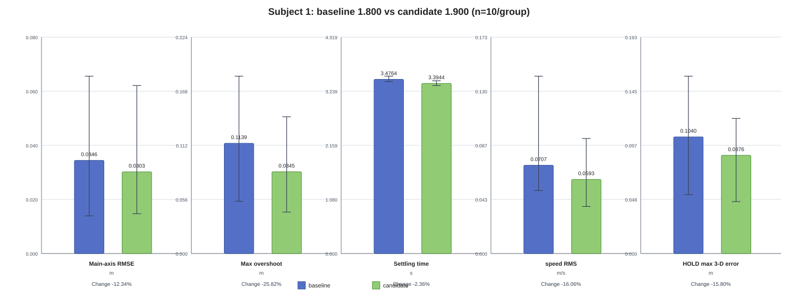
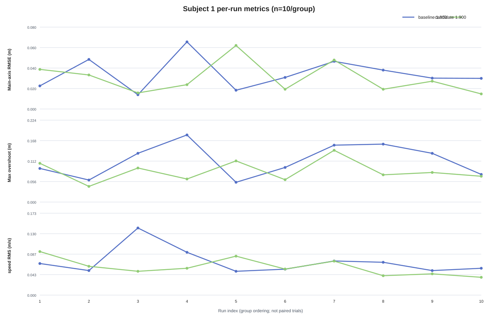
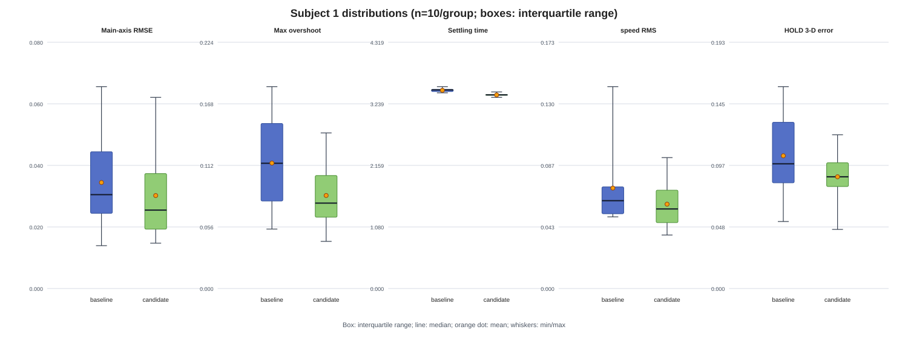

# Subject 1 Parameter Replay Report: MPC_XY_VEL_P_ACC 1.800 → 1.900

Report version: v0.2  
Date: 2026-10-19  
Status: provisional replay result  
Platform: PX4 v1.17.0, Gazebo Harmonic, ROS 2 Jazzy, X500 SITL

## 1. Objective

Subject 1 executes: takeoff to 3 m → move 2 m north → hold for 5 s → automatic landing and disarm. The purpose is to compare `MPC_XY_VEL_P_ACC=1.800` (baseline) with `1.900` (candidate) under the same task, software version, event windows and metric definitions. Coordinates use PX4 local NED (x north, y east, z down).

## 2. Configuration

| Item | Value |
|---|---|
| PX4 commit | `d6f12ad1c4f70ad3230afd7d86e971421e02fef4` |
| Hardware target | `PX4_SITL` |
| Task node | `px4_control_experiment`, `build=2026-10-14-v3` |
| Compared parameter | `MPC_XY_VEL_P_ACC: 1.800 → 1.900` |
| Other key parameters | `MPC_XY_P=0.950`, `MPC_XY_VEL_I_ACC=0.400`, `MPC_ACC_HOR_MAX=5.000`, `MPC_XY_VEL_MAX=12.000` |
| Runs | 10 baseline + 10 candidate |

## 3. Metrics and quality

Response time is measured from the response event to HOLD. Settling time requires the declared position/velocity tolerance for 1 s. Overshoot is the maximum positive main-axis error in the response window. HOLD metrics use valid finite samples only; NaN values are not replaced with zero.

| Group | Runs | Successful | Recording | Reset | Preflight issue | Failsafe | ULog dropout | Missing key window |
|---|---:|---:|---:|---:|---:|---:|---:|---:|
| baseline | 10 | 10/10 | 10/10 | 10/10 | 9/10 | 0/10 | 0/10 | 0/10 |
| candidate | 10 | 10/10 | 10/10 | 10/10 | 10/10 | 0/10 | 0/10 | 0/10 |

All 20 runs landed and disarmed. Reset and preflight events are retained as quality covariates; they are not attributed to the parameter. The result is limited to this SITL condition because the anomaly ratios are not identical between groups.

## 4. Group comparison

| Metric | Baseline mean | Candidate mean | Absolute change | Relative change | Assessment |
|---|---:|---:|---:|---:|---|
| Response time (s) | 3.507200 | 3.410000 | -0.097200 | -2.77% | Improved |
| Settling time (s) | 3.476400 | 3.394400 | -0.082000 | -2.36% | Improved |
| Maximum overshoot (m) | 0.113889 | 0.084472 | -0.029417 | -25.83% | Improved |
| Main-axis RMSE (m) | 0.034625 | 0.030344 | -0.004281 | -12.36% | Improved |
| Steady-state error (m) | 0.027848 | 0.025201 | -0.002647 | -9.51% | Improved |
| Lateral RMSE (m) | 0.031062 | 0.031184 | +0.000121 | +0.39% | Essentially unchanged |
| Altitude RMSE (m) | 0.036778 | 0.031098 | -0.005680 | -15.44% | Improved |
| Speed RMS (m/s) | 0.070661 | 0.059329 | -0.011332 | -16.04% | Improved |
| HOLD maximum 3-D error (m) | 0.104016 | 0.087559 | -0.016457 | -15.82% | Improved |
| Task completion | 10/10 | 10/10 | 0 | 0% | Unchanged |

## 5. Figures

Error bars show the per-run minimum-to-maximum range. These figures reproduce the values in this report and do not replace the raw run directories or ULogs.

## 6. Control interpretation

The ROS samples show lower main-axis RMSE, overshoot and speed RMS for the candidate. The ULog comparison also shows a lower candidate velocity-tracking error in the braking window. The observed acceleration and velocity setpoints did not reach `MPC_ACC_HOR_MAX=5.0` or `MPC_XY_VEL_MAX=12.0`; there is therefore no evidence to change those limits. Position-loop and integral-term changes are not independently supported.

## 7. Conclusion

**Result: `provisional improved`.** Under this Subject 1 SITL condition, `1.900` improves the main-axis response while preserving 100% task completion. The conclusion is local to Subject 1 and does not accept `1.900` for all three subjects. Subject 2 and Subject 3 regression results must be considered; reset and preflight differences remain limitations.

Figures were reconstructed from rounded per-run table values. Small rounding differences from the higher-precision group summary are expected; use the comparison table for the reported aggregate changes.
