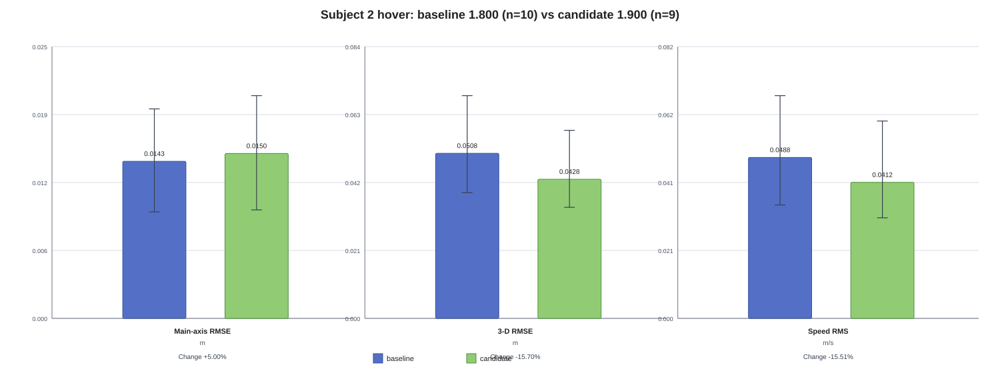
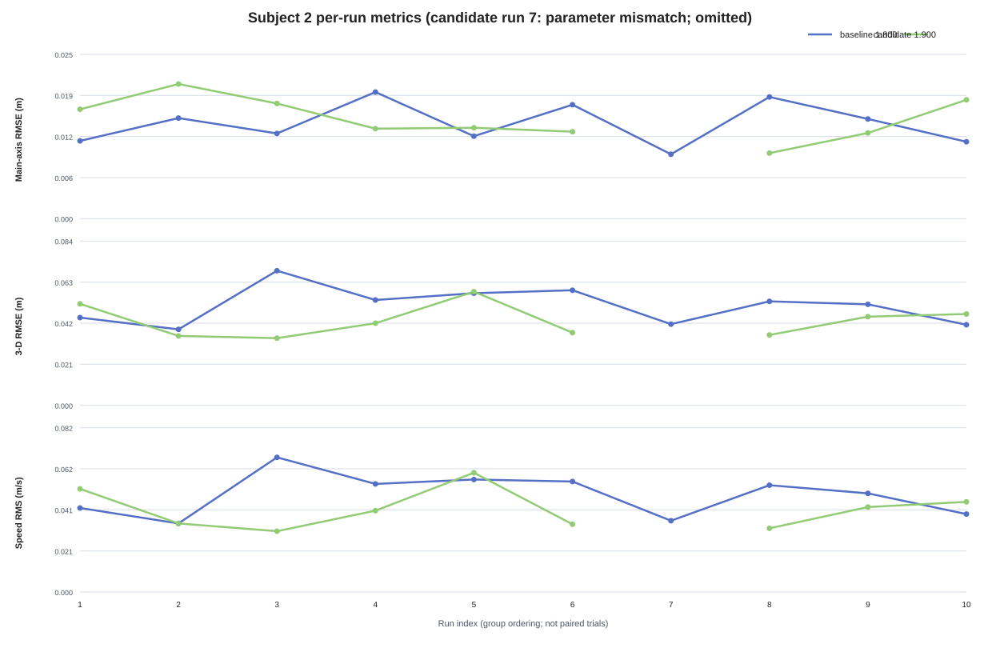

# Subject 2 Baseline / Candidate Comparison Report

Subject: 30 s hover  
Parameter: `MPC_XY_VEL_P_ACC=1.800 → 1.900`  
PX4: v1.17.0, commit `d6f12ad1c4f70ad3230afd7d86e971421e02fef4`  
Final result: **`inconclusive`**

## 1. Scope and data quality

The task is takeoff to 3 m → hover for 30 s → automatic landing and disarm. The same PX4 local NED frame, HOLD event window and metric implementation are used for both groups. Baseline has 10 runs. Candidate has 10 packages, but one run was actually recorded with parameter `1.800`; therefore only 9 runs are valid `1.900` candidates.

| Group | Runs | Parameter | Quality | Task completion | Reset | ULog dropout | Failsafe / takeover |
|---|---:|---:|---|---:|---:|---:|---:|
| baseline | 10 | 1.800 | 10 `review_required` | 10/10 | 10/10 | 0 | 0 / 0 |
| candidate package | 10 | mixed | 10 `review_required` | 10/10 | 10/10 | 0 | 0 / 0 |
| effective candidate | 9 | 1.900 | 9 `review_required` | 9/9 | 9/9 | 0 | 0 / 0 |

`review_required` does not make the task metrics unusable. Both groups contain estimator resets and runtime preflight flags, so they remain quality covariates rather than proof of a parameter effect. HOLD windows contain valid samples and no critical field loss. The candidate parameter mismatch is retained and excluded from the effective 1.900 mean.

## 2. Metric definition

The HOLD window is `state -> HOLD` through `hold complete`. Metrics use finite position, target and velocity samples with all four validity fields equal to 1. NaN values are not replaced with zero. Because hover has no position step, “maximum overshoot” means maximum 3-D position deviation during HOLD. Settling time is 0 s for both groups and has no discrimination in this batch.

## 3. Group comparison

| Metric | Baseline mean | Effective 1.900 mean | Absolute change | Relative change | Direction |
|---|---:|---:|---:|---:|---|
| Main-axis RMSE (m) | 0.014266 | 0.014980 | +0.000714 | +5.01% | Degraded |
| Lateral RMSE (m) | 0.014398 | 0.013156 | -0.001242 | -8.63% | Improved |
| Altitude RMSE (m) | 0.046338 | 0.037459 | -0.008879 | -19.16% | Improved |
| 3-D position RMSE (m) | 0.050793 | 0.042817 | -0.007976 | -15.70% | Improved |
| Maximum 3-D deviation (m) | 0.095696 | 0.086398 | -0.009298 | -9.72% | Improved |
| Settling time (s) | 0.000000 | 0.000000 | unavailable | unavailable | No discrimination |
| Steady-state 3-D error (m) | 0.044546 | 0.040265 | -0.004281 | -9.61% | Improved |
| Speed RMS (m/s) | 0.048754 | 0.041193 | -0.007561 | -15.51% | Improved |
| Maximum speed (m/s) | 0.090061 | 0.076875 | -0.013186 | -14.64% | Improved |
| Task completion | 10/10 | 10/10 | 0 | 0% | Unchanged |

## 4. Figures

The per-run figure leaves the parameter-mismatch candidate run blank instead of presenting it as a 1.900 run.

## 5. Confounders and interpretation

- One candidate package was actually `1.800`, so the candidate group is incomplete for causal comparison.
- Both groups contain estimator resets; runtime preflight flag ratios are not identical.
- Task completion is 100% in both groups, with no failsafe, takeover or ULog dropout.
- The main-axis RMSE increased by 5.01%, while other position and speed metrics decreased. Settling time has no discrimination.
- Position CSV metrics alone cannot prove a velocity-loop, acceleration-limit or actuator-saturation mechanism.

## 6. Conclusion and action

**Result: `inconclusive`.** The data shows mixed metric directions and an incomplete effective candidate group. Do not formally accept `1.900`; retain `1.800` as the rollback value. A new comparison requires at least 10 correctly verified `1.900` runs with the same quality and parameter-readback procedure.
