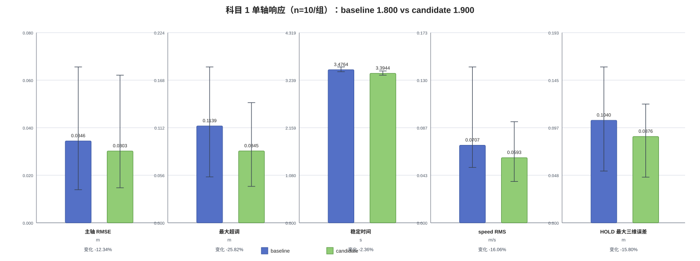
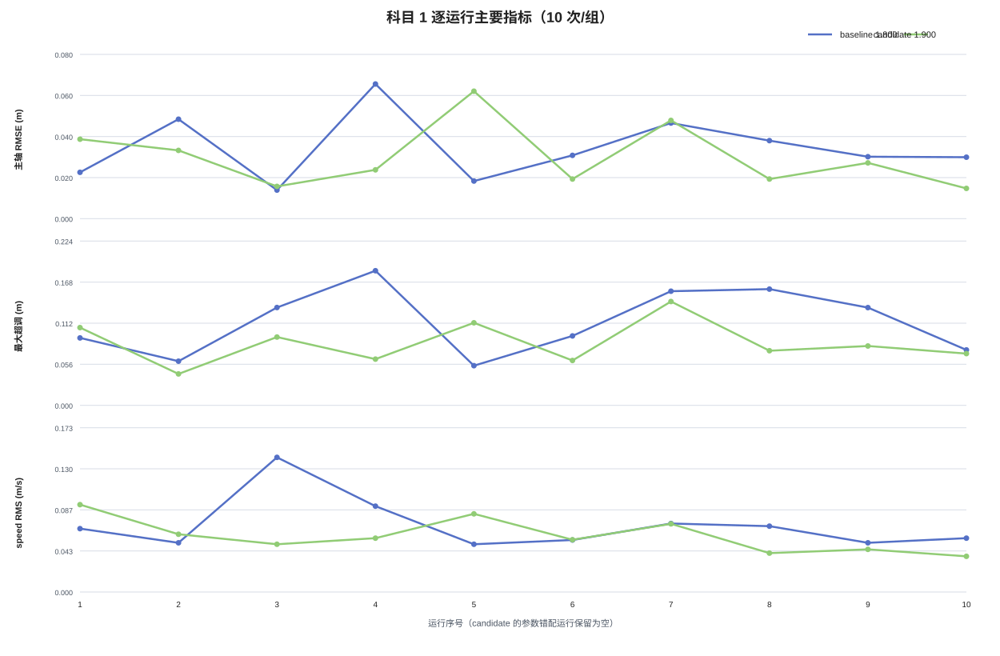
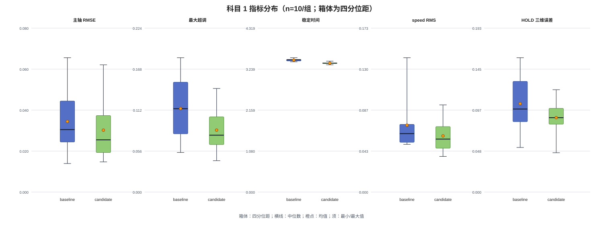

# 科目 1 参数复测实验报告：MPC_XY_VEL_P_ACC 1.800 → 1.900

报告版本：v0.2  
实验日期：2026-10-19  
报告状态：复测（provisional）  
负责人：项目组

## 1. 背景与目标

本报告记录在 PX4 v1.17.0、ROS 2 Jazzy、Gazebo Harmonic、X500 SITL 下，对科目 1 单轴水平位置变化进行的基线—候选参数复测。目标是在任务、软件版本、记录器和指标定义固定的条件下，判断将 `MPC_XY_VEL_P_ACC` 从 1.800 改为 1.900 是否改善控制表现，同时保持任务可靠性。

实验流程：起飞 3 m → 北向移动 2 m → HOLD 5 s → 自动降落并上锁。坐标系为 PX4 local NED（x 北、y 东、z 向下）。

## 2. 系统与版本

| 项目 | 配置 |
|---|---|
| PX4 | v1.17.0 |
| PX4 git | `d6f12ad1c4f70ad3230afd7d86e971421e02fef4` |
| 硬件目标 | `PX4_SITL` |
| Gazebo / ROS 2 | Gazebo Harmonic / ROS 2 Jazzy |
| 任务节点 | `px4_control_experiment`，`build=2026-10-14-v3` |
| 参数快照 | 每次 ULog 的 `initial_parameters` |
| 对比变量 | `MPC_XY_VEL_P_ACC`: 1.800 → 1.900 |
| 其余关键参数 | `MPC_XY_P=0.950`，`MPC_XY_VEL_I_ACC=0.400`，`MPC_ACC_HOR_MAX=5.000`，`MPC_XY_VEL_MAX=12.000` |

## 3. 实验设计与指标

baseline 与 candidate 各 10 次，共 20 次；两组使用相同任务配置、事件窗口和指标脚本。响应时间为 `HOLD 开始 − SINGLE_AXIS_RESPONSE 开始`。稳定时间采用从响应开始首次连续满足 1 s 位置/速度容差的规则。最大超调为 RESPONSE 窗口内 `max(x-target_x, 0)`。HOLD 指标仅使用事件窗口内有效样本，NaN 未填 0。

## 4. 数据质量审计

| 组 | 运行数 | flight_success | recording_ok | reset | preflight issue | failsafe | ULog dropout | 关键窗口缺失 |
|---|---:|---:|---:|---:|---:|---:|---:|---:|
| baseline | 10 | 10/10 | 10/10 | 10/10 | 9/10 | 0/10 | 0/10 | 0/10 |
| candidate | 10 | 10/10 | 10/10 | 10/10 | 10/10 | 0/10 | 0/10 | 0/10 |

两组 20 次均完成降落并上锁；无 failsafe、人工接管和 ULog dropout。关键 RESPONSE/HOLD 位置、目标、速度字段均完整。两组均存在 estimator reset，且位于主要响应窗口前；baseline 有 9/10 次 preflight issue，candidate 有 10/10 次。Offboard loss 均发生在进入 LANDING 后的控制权交接阶段。异常运行均保留，未从统计中删除。

reset、preflight issue、时间戳异常作为质量协变量记录，不能单独解释为参数造成的控制改善。由于两组异常比例不完全相同，结论限定为同工况 SITL 下的 provisional 结果。

## 5. 基准与候选逐运行指标

| 组 | run_id | 响应时间 (s) | 稳定时间 (s) | 最大超调 (m) | 主轴 RMSE (m) | 稳态误差 (m) | 横向 RMSE (m) | 高度 RMSE (m) | speed RMS (m/s) | HOLD 最大三维误差 (m) |
|---|---|---:|---:|---:|---:|---:|---:|---:|---:|---:|
| baseline |  1| 3.4920 | 3.4920 | 0.0918 | 0.0227 | 0.0213 | 0.0449 | 0.0400 | 0.0668 | 0.0956 |
| baseline |  2| 3.4800 | 3.4360 | 0.0601 | 0.0487 | 0.0425 | 0.0399 | 0.0073 | 0.0519 | 0.0999 |
| baseline | 3 | 3.5800 | 3.5400 | 0.1332 | 0.0140 | 0.0095 | 0.0379 | 0.1292 | 0.1420 | 0.1472 |
| baseline |  4| 3.5320 | 3.4920 | 0.1833 | 0.0659 | 0.0526 | 0.0200 | 0.0331 | 0.0905 | 0.1582 |
| baseline |  5| 3.4640 | 3.4600 | 0.0540 | 0.0184 | 0.0141 | 0.0141 | 0.0371 | 0.0504 | 0.0525 |
| baseline | 6 | 3.5200 | 3.4840 | 0.0945 | 0.0310 | 0.0243 | 0.0380 | 0.0226 | 0.0548 | 0.0818 |
| baseline | `1792403524209631962` | 3.5280 | 3.4840 | 0.1554 | 0.0468 | 0.0358 | 0.0336 | 0.0164 | 0.0722 | 0.1158 |
| baseline | `1792403807742027837` | 3.4840 | 3.4520 | 0.1582 | 0.0382 | 0.0278 | 0.0312 | 0.0297 | 0.0694 | 0.1351 |
| baseline | `1792403908758960628` | 3.5240 | 3.4920 | 0.1330 | 0.0303 | 0.0252 | 0.0244 | 0.0195 | 0.0519 | 0.0860 |
| baseline | `1792404072073001102` | 3.4680 | 3.4320 | 0.0754 | 0.0301 | 0.0253 | 0.0266 | 0.0328 | 0.0568 | 0.0681 |

| 组 | run_id | 响应时间 (s) | 稳定时间 (s) | 最大超调 (m) | 主轴 RMSE (m) | 稳态误差 (m) | 横向 RMSE (m) | 高度 RMSE (m) | speed RMS (m/s) | HOLD 最大三维误差 (m) |
|---|---|---:|---:|---:|---:|---:|---:|---:|---:|---:|
| candidate | `1792397073172928768` | 3.4160 | 3.3880 | 0.1058 | 0.0389 | 0.0345 | 0.0321 | 0.0654 | 0.0921 | 0.1051 |
| candidate | `1792397253500264604` | 3.4240 | 3.3920 | 0.0428 | 0.0334 | 0.0266 | 0.0421 | 0.0409 | 0.0609 | 0.0954 |
| candidate | `1792397350006467859` | 3.4320 | 3.3920 | 0.0930 | 0.0158 | 0.0119 | 0.0320 | 0.0278 | 0.0504 | 0.0789 |
| candidate | `1792397532001223195` | 3.3760 | 3.3600 | 0.0629 | 0.0239 | 0.0189 | 0.0308 | 0.0492 | 0.0568 | 0.0920 |
| candidate | `1792398390317677421` | 3.4000 | 3.4000 | 0.1124 | 0.0624 | 0.0570 | 0.0208 | 0.0362 | 0.0824 | 0.0996 |
| candidate | `1792401657932478035` | 3.4520 | 3.4120 | 0.0611 | 0.0194 | 0.0152 | 0.0432 | 0.0363 | 0.0551 | 0.0831 |
| candidate | `1792401831273745565` | 3.3520 | 3.3520 | 0.1413 | 0.0481 | 0.0393 | 0.0313 | 0.0187 | 0.0719 | 0.1205 |
| candidate | `1792401936912969036` | 3.4000 | 3.4000 | 0.0743 | 0.0194 | 0.0153 | 0.0264 | 0.0150 | 0.0410 | 0.0718 |
| candidate | `1792402043824692108` | 3.4000 | 3.4000 | 0.0808 | 0.0273 | 0.0201 | 0.0257 | 0.0091 | 0.0450 | 0.0831 |
| candidate | `1792402174723694357` | 3.4480 | 3.4480 | 0.0704 | 0.0148 | 0.0133 | 0.0274 | 0.0125 | 0.0376 | 0.0463 |

## 6. 分组汇总

| 指标 | baseline 均值 | 中位数 | 标准差 | 范围 | candidate 均值 | 中位数 | 标准差 | 范围 |
|---|---:|---:|---:|---|---:|---:|---:|---|
| 响应时间 | 3.507200 | 3.506000 | 0.036064 | 3.464000–3.580000 | 3.410000 | 3.408000 | 0.031170 | 3.352000–3.452000 |
| 稳定时间 | 3.476400 | 3.484000 | 0.032246 | 3.432000–3.540000 | 3.394400 | 3.396000 | 0.026479 | 3.352000–3.448000 |
| 最大超调 | 0.113889 | 0.113750 | 0.044801 | 0.053951–0.183255 | 0.084472 | 0.077544 | 0.029059 | 0.042805–0.141291 |
| 主轴 RMSE | 0.034625 | 0.030657 | 0.015712 | 0.014042–0.065887 | 0.030344 | 0.025633 | 0.015543 | 0.014760–0.062429 |
| 稳态误差 | 0.027848 | 0.025287 | 0.012847 | 0.009484–0.052568 | 0.025201 | 0.019501 | 0.014458 | 0.011918–0.056996 |
| 横向 RMSE | 0.031062 | 0.032380 | 0.009702 | 0.014125–0.044949 | 0.031184 | 0.031038 | 0.006993 | 0.020823–0.043204 |
| 高度 RMSE | 0.036778 | 0.031247 | 0.034000 | 0.007327–0.129153 | 0.031098 | 0.031987 | 0.017987 | 0.009062–0.065440 |
| speed RMS | 0.070661 | 0.061797 | 0.028016 | 0.050404–0.142012 | 0.059329 | 0.055967 | 0.017892 | 0.037622–0.092054 |
| HOLD 最大三维误差 | 0.104016 | 0.097730 | 0.034581 | 0.052476–0.158239 | 0.087559 | 0.087516 | 0.020221 | 0.046259–0.120455 |

### 6.1 变化率

变化率为 `(candidate − baseline) / baseline`；误差、时间和速度均按越低越好解释。

| 指标 | 绝对差值 | 相对变化 | 评价 |
|---|---:|---:|---|
| 响应时间 | -0.097200 | -2.77% | 改善 |
| 稳定时间 | -0.082000 | -2.36% | 改善 |
| 最大超调 | -0.029417 | -25.83% | 改善 |
| 主轴 RMSE | -0.004281 | -12.36% | 改善 |
| 稳态误差 | -0.002647 | -9.51% | 改善 |
| 横向 RMSE | +0.000121 | +0.39% | 退化 |
| 高度 RMSE | -0.005680 | -15.44% | 改善 |
| speed RMS | -0.011332 | -16.04% | 改善 |
| HOLD 最大三维误差 | -0.016457 | -15.82% | 改善 |

任务完成率：baseline 10/10 = 100%，candidate 10/10 = 100%，无变化。

## 7. 图表

图中误差线表示每组逐运行指标的最小值—最大值；科目 1 两组各 10 次。图表只展示报告第 5、6 节已有数据，不替代原始运行目录和 ULog。

## 8. Agent 分析与控制证据

### 8.1 观测事实

- `samples.csv` 的 RESPONSE/HOLD 窗口中，关键位置、目标和速度字段有效；HOLD 主轴 RMSE 均值由 0.034625 m 降至 0.030344 m，稳定时间由 3.4764 s 降至 3.3944 s。
- 最大超调均值由 0.113889 m 降至 0.084472 m，speed RMS 由 0.070661 m/s 降至 0.059329 m/s；横向 RMSE 由 0.031062 m 变为 0.031184 m，基本持平。
- ULog 的 `vehicle_local_position_setpoint.vx` 与 `vehicle_local_position.vx` 在目标穿越后的制动窗口显示，候选组速度跟踪误差绝对值约下降 15.3%，最大实测 vx 约由 0.550 m/s 降至 0.465 m/s。
- ULog 中 `vehicle_local_position_setpoint.acceleration[0]` 未触发 `MPC_ACC_HOR_MAX=5.0`，速度设定未触发 `MPC_XY_VEL_MAX=12.0`；不支持修改限幅参数。
- ULog 的 `vehicle_status.failsafe=0`，执行器饱和标志未出现；Offboard loss 在 LANDING handoff 后。

### 8.2 控制环节判断

本轮变化与水平速度环 P 对制动段速度跟踪的改善方向一致，因此候选优先归因于 `MPC_XY_VEL_P_ACC` 的局部作用；位置环、积分项和限幅没有独立证据证明需要改动。reset 和 preflight issue 是数据质量问题，报告中与控制性能分开处理。

## 9. 结论

**结论：`improved`，但为 `provisional improved`。**

在同一科目、同一任务配置、同一 PX4 版本和同一指标定义下，candidate 相对 baseline 的主轴 RMSE、最大超调、稳定时间、稳态误差和 speed RMS 均下降，横向误差基本持平，任务完成率保持 100%。这足以支持当前同工况 SITL 的临时改善判断，但不能替代科目 2/3 回归，也不能把 reset/preflight 异常差异忽略掉。本结论只适用于科目 1，不代表三个科目整体接受 1.900。

图表根据报告中已舍入的逐运行表重建，因此图内变化率与高精度汇总可能存在小幅舍入差异；精确汇总以指标对比表为准。
