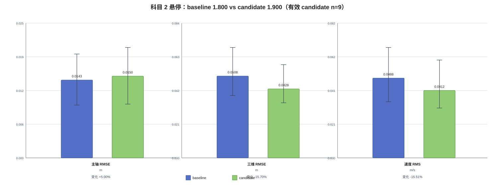
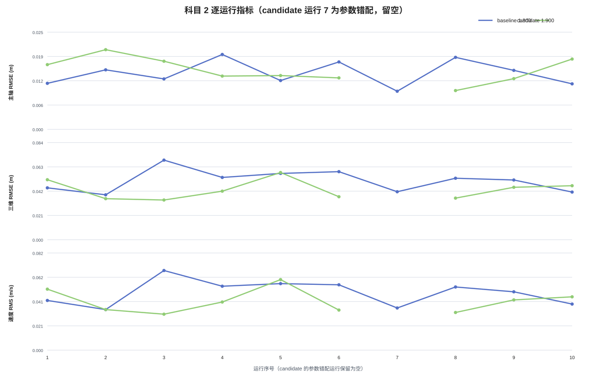

# 科目 2 baseline / candidate 对比报告（更新版）

数据按同一 PX4 local NED、同一任务（起飞 3 m→悬停 30 s→降落上锁）、同一 `events.csv` Hold 窗口和同一指标实现比较。baseline 使用 3/6/8 的新补测包替换旧包；candidate 使用当前 `hover_capture_modified1.zip`、`modified2`–`modified6`、`modified8`，以及本次替换的 `modified7(2)`、`modified9（2）`、`modified10(2)`。旧包保留但不用于本次主统计。

| 项目 | 值 |
|---|---|
| PX4 / Gazebo / ROS 2 | v1.17.0 / Harmonic / Jazzy |
| PX4 commit | `d6f12ad1c4f70ad3230afd7d86e971421e02fef4` |
| 对比参数 | `MPC_XY_VEL_P_ACC: 1.800 → 1.900` |
| 主比较集 | baseline 10 次；candidate 10 次，其中有效 1.900 为 9 次 |
| 最终结论 | `inconclusive` |

## 1. 数据质量表

| 组 | 序号 | run_id | MPC_XY_VEL_P_ACC | 分级 | 哈希 | 成功 | 记录 | 最终状态 | 指标样本 | Hold preflight坏 | reset | dropout | failsafe | 接管 | 质量原因 |
|---|---|---|---|---|---|---|---|---|---|---|---|---|---|---|---|
| baseline | 1 | `hover_capture_20261020T093301Z_52da919d` | 1.800 | review_required | True | true | true | IDLE | 611 | False | True | 0 | False | False | estimator_reset_seen;preflight_issue |
| baseline | 2 | `hover_capture_20261020T094126Z_ae9c9b66` | 1.800 | review_required | True | true | true | IDLE | 614 | False | True | 0 | False | False | estimator_reset_seen;preflight_issue |
| baseline | 3 | `hover_capture_20261021T034751Z_400c3911` | 1.800 | review_required | True | true | true | IDLE | 607 | False | True | 0 | False | False | estimator_reset_seen;preflight_issue |
| baseline | 4 | `hover_capture_20261020T021656Z_529d8674` | 1.800 | review_required | True | true | true | IDLE | 606 | False | True | 0 | False | False | estimator_reset_seen;preflight_issue |
| baseline | 5 | `hover_capture_20261020T021519Z_b6491eb2` | 1.800 | review_required | True | true | true | IDLE | 606 | False | True | 0 | False | False | estimator_reset_seen;preflight_issue |
| baseline | 6 | `hover_capture_20261021T035212Z_9d102345` | 1.800 | review_required | True | true | true | IDLE | 625 | False | True | 0 | False | False | estimator_reset_seen;preflight_issue |
| baseline | 7 | `hover_capture_20261020T024626Z_13476211` | 1.800 | review_required | True | true | true | IDLE | 616 | False | True | 0 | False | False | estimator_reset_seen;preflight_issue |
| baseline | 8 | `hover_capture_20261021T035044Z_fbdf10cd` | 1.800 | review_required | True | true | true | IDLE | 607 | False | True | 0 | False | False | estimator_reset_seen;preflight_issue |
| baseline | 9 | `hover_capture_20261020T025634Z_f0736523` | 1.800 | review_required | True | true | true | IDLE | 611 | False | True | 0 | False | False | estimator_reset_seen |
| baseline | 10 | `hover_capture_20261020T025810Z_77a910ec` | 1.800 | review_required | True | true | true | IDLE | 605 | False | True | 0 | False | False | estimator_reset_seen;preflight_issue |
| candidate | 1 | `hover_capture_20261021T114322Z_afedd3f6` | 1.900 | review_required | True | true | true | IDLE | 608 | False | True | 0 | False | False | estimator_reset_seen;preflight_issue |
| candidate | 2 | `hover_capture_20261020T173724Z_e5e4d11d` | 1.900 | review_required | True | true | true | IDLE | 607 | False | True | 0 | False | False | estimator_reset_seen;preflight_issue |
| candidate | 3 | `hover_capture_20261020T173846Z_e5f7bfe3` | 1.900 | review_required | True | true | true | IDLE | 604 | False | True | 0 | False | False | estimator_reset_seen;preflight_issue |
| candidate | 4 | `hover_capture_20261020T174026Z_167280f7` | 1.900 | review_required | True | true | true | IDLE | 604 | False | True | 0 | False | False | estimator_reset_seen;preflight_issue |
| candidate | 5 | `hover_capture_20261021T010634Z_210ae19c` | 1.900 | review_required | True | true | true | IDLE | 609 | False | True | 0 | False | False | estimator_reset_seen;preflight_issue |
| candidate | 6 | `hover_capture_20261021T011211Z_4e7cc893` | 1.900 | review_required | True | true | true | IDLE | 602 | False | True | 0 | False | False | estimator_reset_seen;preflight_issue |
| candidate | 7 | `hover_capture_20261021T165552Z_ba4a3fcd` | 1.800 | review_required | True | true | true | IDLE | 601 | False | True | 0 | False | False | estimator_reset_seen;preflight_issue;parameter_mismatch_expected_1.900_actual_1.7999999523162842 |
| candidate | 8 | `hover_capture_20261021T011556Z_2ced61f7` | 1.900 | review_required | True | true | true | IDLE | 603 | False | True | 0 | False | False | estimator_reset_seen;preflight_issue |
| candidate | 9 | `hover_capture_20261021T165856Z_ed6d3ccf` | 1.900 | review_required | True | true | true | IDLE | 601 | False | True | 0 | False | False | estimator_reset_seen;preflight_issue |
| candidate | 10 | `hover_capture_20261021T165731Z_e6293dd1` | 1.900 | review_required | True | true | true | IDLE | 601 | False | True | 0 | False | False | estimator_reset_seen;preflight_issue |

质量计数：baseline `{'clean_candidate': 0, 'review_required': 10, 'invalid_for_metric': 0}`；candidate `{'clean_candidate': 0, 'review_required': 10, 'invalid_for_metric': 0}`。本次新替换的 candidate 9、10 实际 ULog 参数为 1.900；candidate 7 仍实际为 1.800，已保留在逐运行表并标记参数错配；有效 1.900 candidate 有 `9` 次。

版本和任务审计：20/20 ULog 为 PX4 v1.17.0、同一 commit `d6f12ad1c4f70ad3230afd7d86e971421e02fef4`、同一 `PX4_SITL`，20/20 无 ULog dropout，任务参数和 Hold 任务一致。两组参数分别为 1.800 和 1.900，其他控制参数保持 baseline 报告中的一致值。外部独立参数快照仍缺失，参数证据来自 ULog embedded initial parameters。

## 2. 逐运行指标

| 组 | 序号 | run_id | Hold起点 | Hold终点 | n | 主轴RMSE | 横向RMSE | 高度RMSE | 三维RMSE | 最大偏差 | 稳定时间 | 稳态误差 | 速度RMS | 最大速度 | 任务 |
|---|---|---|---|---|---|---|---|---|---|---|---|---|---|---|---|
| baseline | 1 | `hover_capture_20261020T093301Z_52da919d` | 229.876 | 259.908 | 611 | 0.011689 | 0.014944 | 0.040440 | 0.044669 | 0.104219 | 0.000000 | 0.037872 | 0.042087 | 0.098443 | success |
| baseline | 2 | `hover_capture_20261020T094126Z_ae9c9b66` | 728.192 | 758.236 | 614 | 0.015114 | 0.015602 | 0.032013 | 0.038687 | 0.091256 | 0.000000 | 0.028657 | 0.034351 | 0.081143 | success |
| baseline | 3 | `hover_capture_20261021T034751Z_400c3911` | 444.580 | 474.596 | 607 | 0.012809 | 0.016107 | 0.065383 | 0.068545 | 0.093391 | 0.000000 | 0.077815 | 0.067477 | 0.092755 | success |
| baseline | 4 | `hover_capture_20261020T021656Z_529d8674` | 147.064 | 177.096 | 606 | 0.019027 | 0.016355 | 0.047369 | 0.053604 | 0.070704 | 0.000000 | 0.061131 | 0.054151 | 0.077643 | success |
| baseline | 5 | `hover_capture_20261020T021519Z_b6491eb2` | 54.332 | 84.356 | 606 | 0.012402 | 0.012792 | 0.054250 | 0.057101 | 0.098725 | 0.000000 | 0.029897 | 0.056358 | 0.098296 | success |
| baseline | 6 | `hover_capture_20261021T035212Z_9d102345` | 154.720 | 184.752 | 625 | 0.017122 | 0.013466 | 0.054410 | 0.058608 | 0.108365 | 0.000000 | 0.069470 | 0.055354 | 0.100888 | success |
| baseline | 7 | `hover_capture_20261020T024626Z_13476211` | 73.400 | 103.420 | 616 | 0.009676 | 0.015297 | 0.037165 | 0.041339 | 0.100936 | 0.000000 | 0.025040 | 0.035720 | 0.090315 | success |
| baseline | 8 | `hover_capture_20261021T035044Z_fbdf10cd` | 68.628 | 98.628 | 607 | 0.018282 | 0.013388 | 0.047851 | 0.052945 | 0.085498 | 0.000000 | 0.029377 | 0.053538 | 0.080626 | success |
| baseline | 9 | `hover_capture_20261020T025634Z_f0736523` | 97.604 | 127.652 | 611 | 0.014979 | 0.016650 | 0.046270 | 0.051405 | 0.122999 | 0.000000 | 0.051556 | 0.049447 | 0.110226 | success |
| baseline | 10 | `hover_capture_20261020T025810Z_77a910ec` | 188.116 | 218.156 | 605 | 0.011561 | 0.009377 | 0.038230 | 0.041026 | 0.080868 | 0.000000 | 0.034647 | 0.039055 | 0.070280 | success |
| candidate | 1 | `hover_capture_20261021T114322Z_afedd3f6` | 207.636 | 237.668 | 608 | 0.016438 | 0.017796 | 0.045622 | 0.051656 | 0.074563 | 0.000000 | 0.055638 | 0.051698 | 0.068646 | success |
| candidate | 2 | `hover_capture_20261020T173724Z_e5e4d11d` | 265.036 | 295.040 | 607 | 0.020232 | 0.011582 | 0.026564 | 0.035343 | 0.075584 | 0.000000 | 0.048571 | 0.034350 | 0.103699 | success |
| candidate | 3 | `hover_capture_20261020T173846Z_e5f7bfe3` | 345.348 | 375.352 | 604 | 0.017307 | 0.012099 | 0.026880 | 0.034182 | 0.066055 | 0.000000 | 0.041690 | 0.030470 | 0.055208 | success |
| candidate | 4 | `hover_capture_20261020T174026Z_167280f7` | 443.348 | 473.360 | 604 | 0.013527 | 0.014905 | 0.036671 | 0.041832 | 0.060570 | 0.000000 | 0.043989 | 0.040792 | 0.061268 | success |
| candidate | 5 | `hover_capture_20261021T010634Z_210ae19c` | 108.540 | 138.568 | 609 | 0.013659 | 0.012209 | 0.054889 | 0.057866 | 0.103510 | 0.000000 | 0.042400 | 0.059794 | 0.103843 | success |
| candidate | 6 | `hover_capture_20261021T011211Z_4e7cc893` | 81.660 | 111.680 | 602 | 0.013074 | 0.012236 | 0.032409 | 0.037027 | 0.089498 | 0.000000 | 0.024211 | 0.033943 | 0.060037 | success |
| candidate | 7 | `hover_capture_20261021T165552Z_ba4a3fcd` | 4205.648 | 4235.664 | 601 | 0.016322 | 0.010908 | 0.031725 | 0.037308 | 0.059463 | 0.000000 | 0.043576 | 0.036785 | 0.056849 | success |
| candidate | 8 | `hover_capture_20261021T011556Z_2ced61f7` | 48.548 | 78.588 | 603 | 0.009854 | 0.015343 | 0.030838 | 0.035825 | 0.116913 | 0.000000 | 0.022430 | 0.031931 | 0.086467 | success |
| candidate | 9 | `hover_capture_20261021T165856Z_ed6d3ccf` | 4386.504 | 4416.540 | 601 | 0.012879 | 0.010862 | 0.041878 | 0.045140 | 0.113322 | 0.000000 | 0.043476 | 0.042574 | 0.076537 | success |
| candidate | 10 | `hover_capture_20261021T165731Z_e6293dd1` | 4303.636 | 4333.664 | 601 | 0.017851 | 0.011369 | 0.041381 | 0.046479 | 0.077570 | 0.000000 | 0.039982 | 0.045188 | 0.076172 | success |

Hold 窗口内只使用位置、目标、速度有限且四个 valid 字段为 1 的样本；NaN 没有填 0。最大超调在零位移悬停中表示 Hold 内最大三维偏差，稳定时间按 0.3 m 三轴容差连续 1 s 定义，因此本批 0 s 没有区分度。

## 3. 基线/候选汇总

### baseline (`MPC_XY_VEL_P_ACC=1.800`)

| 指标 | n | 均值 | 中位数 | 标准差 | 最小 | 最大 |
|---|---|---|---|---|---|---|
| 主轴 RMSE (m) | 10 | 0.014266 | 0.013894 | 0.003141 | 0.009676 | 0.019027 |
| 横向 RMSE (m) | 10 | 0.014398 | 0.015121 | 0.002212 | 0.009377 | 0.016650 |
| 高度 RMSE (m) | 10 | 0.046338 | 0.046820 | 0.009909 | 0.032013 | 0.065383 |
| 三维 RMSE (m) | 10 | 0.050793 | 0.052175 | 0.009415 | 0.038687 | 0.068545 |
| 最大超调/最大三维偏差 (m) | 10 | 0.095696 | 0.096058 | 0.014865 | 0.070704 | 0.122999 |
| 稳定时间 (s) | 10 | 0.000000 | 0.000000 | 0.000000 | 0.000000 | 0.000000 |
| 稳态三维误差 (m) | 10 | 0.044546 | 0.036260 | 0.019068 | 0.025040 | 0.077815 |
| 速度 RMS (m/s) | 10 | 0.048754 | 0.051493 | 0.010647 | 0.034351 | 0.067477 |
| 最大速度 (m/s) | 10 | 0.090061 | 0.091535 | 0.012398 | 0.070280 | 0.110226 |

任务完成率：10/10 = 100%；异常数量：reset 10/10，运行级 preflight 标记 9/10，Hold 内 preflight_bad 0/10，invalid 0。

### candidate 有效 1.900 子集（`MPC_XY_VEL_P_ACC=1.900`）

| 指标 | n | 均值 | 中位数 | 标准差 | 最小 | 最大 |
|---|---|---|---|---|---|---|
| 主轴 RMSE (m) | 9 | 0.014980 | 0.013659 | 0.003193 | 0.009854 | 0.020232 |
| 横向 RMSE (m) | 9 | 0.013156 | 0.012209 | 0.002323 | 0.010862 | 0.017796 |
| 高度 RMSE (m) | 9 | 0.037459 | 0.036671 | 0.009394 | 0.026564 | 0.054889 |
| 三维 RMSE (m) | 9 | 0.042817 | 0.041832 | 0.008195 | 0.034182 | 0.057866 |
| 最大超调/最大三维偏差 (m) | 9 | 0.086398 | 0.077570 | 0.020538 | 0.060570 | 0.116913 |
| 稳定时间 (s) | 9 | 0.000000 | 0.000000 | 0.000000 | 0.000000 | 0.000000 |
| 稳态三维误差 (m) | 9 | 0.040265 | 0.042400 | 0.010677 | 0.022430 | 0.055638 |
| 速度 RMS (m/s) | 9 | 0.041193 | 0.040792 | 0.009840 | 0.030470 | 0.059794 |
| 最大速度 (m/s) | 9 | 0.076875 | 0.076172 | 0.018041 | 0.055208 | 0.103843 |

任务完成率（全部 candidate 包）：10/10 = 100%；有效 1.900 子集 n=9。candidate 全部异常数量：reset 10/10，运行级 preflight 标记 10/10，Hold 内 preflight_bad 0/10，参数错配 1/10。有效 1.900 子集 Hold 内 preflight_bad 0/9。

## 4. 变化率

变化率定义为 `(candidate 均值 - baseline 均值) / baseline 均值`。误差和速度指标下降为改善，稳定时间下降为改善。

| 指标 | baseline均值 | candidate均值 | 绝对差 | 相对变化率 | 方向 |
|---|---|---|---|---|---|
| 主轴 RMSE (m) | 0.014266 | 0.014980 | 0.000714 | 5.01 | 退化 |
| 横向 RMSE (m) | 0.014398 | 0.013156 | -0.001242 | -8.63 | 改善 |
| 高度 RMSE (m) | 0.046338 | 0.037459 | -0.008879 | -19.16 | 改善 |
| 三维 RMSE (m) | 0.050793 | 0.042817 | -0.007976 | -15.70 | 改善 |
| 最大超调/最大三维偏差 (m) | 0.095696 | 0.086398 | -0.009298 | -9.72 | 改善 |
| 稳定时间 (s) | 0.000000 | 0.000000 | 0.000000 | unavailable | 不变 |
| 稳态三维误差 (m) | 0.044546 | 0.040265 | -0.004281 | -9.61 | 改善 |
| 速度 RMS (m/s) | 0.048754 | 0.041193 | -0.007561 | -15.51 | 改善 |
| 最大速度 (m/s) | 0.090061 | 0.076875 | -0.013186 | -14.64 | 改善 |

## 5. 图表

图表使用本报告的最终统计：baseline 为 10 次 `1.800`，candidate 只纳入实际读回为 `1.900` 的 9 次。candidate 序号 7 的参数实际为 `1.800`，因此在逐运行图中留空并保留在质量表中，不把它误画成 1.900。

## 6. 异常与混杂因素

- 本次替换的 candidate 9、10 的 ULog `initial_parameters` 为 1.900；candidate 7 的 ULog 实际为 1.800，已从有效 candidate 均值排除但未删除。其余 9 个 candidate 运行的 ULog 参数为 1.900；baseline 10/10 均为 1.800。
- baseline 的 Hold 内 `preflight_ok` 为 10/10 通过；有效 1.900 candidate 的 Hold 内 `preflight_ok` 为 9/9 通过。运行级 preflight 标记仍存在，不能把历史预检标记当作参数效果。
- 两组均为 estimator reset review_required，reset 发生在起飞阶段；不能把它归因于参数，也不能用候选均值掩盖这一质量差异。
- 任务完成率两组均为 100%，无 failsafe、人工接管或 ULog dropout；这只能说明任务链完成，不能证明控制因果。
- Hold 稳定时间两组均为 0 s，没有辨识力。CSV 是接收采样，不能单凭位置指标证明速度环、加速度限幅或执行器饱和的原因。

## 7. 最终结论

**inconclusive**。

有效 1.900 candidate 有 9 次。其均值中主轴 RMSE 上升 5.01%，横向、高度、三维、最大偏差、稳态误差和速度指标下降；但两组全部运行仍有 estimator reset，candidate 运行级 preflight 标记为 10/10，且 candidate 7 的替换包仍是 1.800 参数。由于候选组不完整且存在参数错配，本次结论只能是 `inconclusive`，不能正式接受 1.900。

## 8. 下一步行动

1. 暂不正式接受 1.900；保留 1.800 作为回退值，不执行参数写入。
2. 若要判定候选，继续做至少 10 次 baseline 1.800 与 10 次 candidate 1.900 的严格配对复测；每次启动后读回并保存参数/版本快照。
3. 接受条件：主轴和三维 RMSE、速度 RMS 在同一质量分层下重复改善；任务完成率不下降；无新增 failsafe、人工接管、关键字段缺失或执行器饱和；科目 3 回归不退化。
4. 拒绝/回退条件：主轴或三维 RMSE 重复未改善、任务失败、failsafe/接管、参数读回错误或数据质量不对称；回退到 `MPC_XY_VEL_P_ACC=1.800`。
